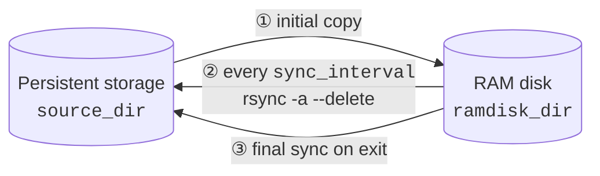

<p align="center">
  
</p>

<h1 align="center">GnuRAMage</h1>

<p align="center">
  Keep a working set on a RAM disk. Keep the persistent copy in sync. Lose nothing on power loss.
</p>

<p align="center">
  <a href="https://github.com/FPGArtktic/GnuRAMage/actions/workflows/ci.yml"></a>
  <a href="https://gnuramage.readthedocs.io/en/latest/"></a>
  <a href="https://github.com/FPGArtktic/GnuRAMage/releases"></a>
  <a href="LICENSE"></a>
  <a href="#requirements"></a>
  <a href="#requirements"></a>
  <a href="https://github.com/FPGArtktic/GnuRAMage/commits/master"></a>
</p>

---

**Documentation:** [gnuramage.readthedocs.io](https://gnuramage.readthedocs.io/) — user guide,
architecture (component, sequence, activity and state diagrams), data safety model, roadmap.

## Overview

GnuRAMage is a single-file Bash tool for hosts with large RAM disks (tmpfs/ramfs).
It copies a directory tree from persistent storage to the RAM disk once, then
periodically writes changes back with `rsync`, and performs a final sync on shutdown.
Workloads get RAM-speed I/O; the persistent copy stays current.

- Single script, no daemon framework, no compiled dependencies.
- INI configuration with rsync-style exclude patterns.
- Dry-run, one-shot and continuous modes; leveled logging to console and files.
- Standalone worker scripts can be generated for cron or other schedulers.

## How it works



1. On start, the contents of `source_dir` are copied to `ramdisk_dir`.
2. Every `sync_interval` seconds the RAM disk is mirrored back to `source_dir`
   (`rsync -a --delete`, honouring `[EXCLUDE]` patterns).
3. On `Ctrl+C` / exit, a final sync runs and `sync(1)` flushes page cache to disk.

> [!WARNING]
> **After the initial copy, the RAM disk is the source of truth.** Step ② uses
> `--delete`: files removed on the RAM disk are removed from persistent storage on the
> next sync. Verify that `ramdisk_dir` is mounted and populated before relying on the
> sync-back. Version 1.0.0 does not yet refuse to sync from an empty RAM directory —
> this guard is part of the 1.1.0 work tracked in [CHANGELOG.md](CHANGELOG.md).

## Requirements

| Component | Version |
|-----------|---------|
| GNU/Linux | any current distribution |
| Bash      | ≥ 4.0 |
| rsync     | ≥ 3.1 |
| coreutils, findutils | standard |

Tested in CI on Ubuntu (latest), Debian bookworm and Arch Linux.

## Installation

```bash
git clone https://github.com/FPGArtktic/GnuRAMage.git
cd GnuRAMage
chmod +x gramage.sh
```

Or fetch the two files directly:

```bash
curl -fsSLO https://raw.githubusercontent.com/FPGArtktic/GnuRAMage/master/gramage.sh
curl -fsSLO https://raw.githubusercontent.com/FPGArtktic/GnuRAMage/master/GnuRAMage.ini
chmod +x gramage.sh
```

Release tarballs with `SHA256SUMS` are published on the
[Releases](https://github.com/FPGArtktic/GnuRAMage/releases) page.

> [!NOTE]
> The script writes its generated worker scripts next to itself. Run it from a
> writable directory (for example `~/opt/gnuramage`), not from `/usr/bin`.

## Quick start

```bash
# 1. Mount a RAM disk (example: 64 GiB tmpfs)
sudo mount -t tmpfs -o size=64G tmpfs /mnt/ramdisk

# 2. Configure
$EDITOR GnuRAMage.ini          # set source_dir and ramdisk_dir

# 3. Preview
./gramage.sh --dry-run --verbose

# 4. Run (Ctrl+C performs a final sync and exits)
./gramage.sh --logs gnuramage.log --errors-log gnuramage.err
```

## Configuration

`GnuRAMage.ini` (or any file passed with `--config`). Keys are case-sensitive;
lines starting with `#` or `;` are comments.

```ini
[SETTINGS]
sync_interval = 180
log_level = INFO
verify_checksums = false

[DIRECTORIES]
source_dir = /srv/data
ramdisk_dir = /mnt/ramdisk/data

[EXCLUDE]
*.bak
*.tmp
temp_*
cache/
```

| Section | Key | Type | Default | Description |
|---------|-----|------|---------|-------------|
| `SETTINGS` | `sync_interval` | integer (s) | `180` | Delay between sync-back cycles. |
| `SETTINGS` | `log_level` | `ERROR` \| `WARN` \| `INFO` \| `DEBUG` | `INFO` | Minimum level printed and logged. |
| `SETTINGS` | `verify_checksums` | boolean | `false` | Compare file checksums instead of size and mtime (slower). *Accepted but not yet applied in 1.0.0; see CHANGELOG.* |
| `DIRECTORIES` | `source_dir` | path | — | Persistent directory. **Use a trailing slash in 1.0.0** (`/srv/data/`). |
| `DIRECTORIES` | `ramdisk_dir` | path | — | Directory on the RAM disk. Created if missing. |
| `EXCLUDE` | *(one pattern per line)* | rsync pattern | — | Excluded from the sync-back. Applied as `--exclude=PATTERN`. |

## Command-line reference

```
gramage.sh [OPTIONS]
```

| Option | Description |
|--------|-------------|
| `--config <file>` | Configuration file (default: `GnuRAMage.ini`, looked up in CWD, then next to the script). |
| `--dry-run` | Log what would happen; perform no copy or sync. |
| `--verbose`, `-v` | Pass `-v` to the underlying `cp`/`rsync`. |
| `--logs <file>` | Append all log lines to `<file>`. |
| `--errors-log <file>` | Append `ERROR` and `WARN` lines to a separate file. |
| `--one-time` | Initial copy, one sync-back, exit. |
| `--script-gen-only` | Write `gramage_copy_to_ram.sh` and `gramage_sync_to_disk.sh`, then exit. |
| `--help` | Show usage. |

Exit status is `0` on success and non-zero on configuration, dependency or sync errors.

### Generated worker scripts

`--script-gen-only` produces two self-contained scripts that embed the configured
paths and exclude patterns:

| Script | Action | Flags |
|--------|--------|-------|
| `gramage_copy_to_ram.sh` | `source_dir` → `ramdisk_dir` | `--verbose`, `--dry-run` |
| `gramage_sync_to_disk.sh` | `ramdisk_dir` → `source_dir` (`--delete`) | `--verbose`, `--dry-run` |

They are suitable for cron or a systemd timer when the main loop is not wanted.

## Operational notes

- **Interactive terminal required (1.0.0).** The wait loop reads from stdin; running
  under `nohup`, `systemd` or with `< /dev/null` is not supported in this version.
  A signal-driven loop and a systemd unit are scheduled for 1.1.0.
- **Stopping.** `Ctrl+C` triggers a final sync and a report (start time, duration,
  files copied, sync cycles). Allow it to finish.
- **Logs.** Console output is suppressed in `--dry-run` except for `ERROR` lines.
  Format: `[YYYY-MM-DD HH:MM:SS] [LEVEL] message`.
- **Concurrency.** Run one instance per RAM directory.

## Testing

```bash
cd test
./run_test.sh
```

The suite generates a sample tree under `/tmp/ram_disk_test_*` with
`test_generator.sh`, then exercises script generation, copy, sync-back, exclude
patterns, one-time mode and logging. `rsync` must be installed.

```bash
# Optional: larger fixture
./test_generator.sh --files 500 --dirs 20 --size 1M
```

Static analysis:

```bash
shellcheck -S warning gramage.sh test/*.sh
```

## Contributing

Pull requests are welcome. CI must pass:

1. `shellcheck -S warning` reports nothing.
2. `test/run_test.sh` passes on Ubuntu, Debian and Arch.
3. Behaviour changes come with a regression test and a `CHANGELOG.md` entry.
4. Commit messages follow [Conventional Commits](https://www.conventionalcommits.org/)
   (`feat:`, `fix:`, `docs:`, `test:`, `ci:`, `chore:`, `refactor:`).

Style: 4-space indentation, `snake_case` functions, `local` variables, quoted
expansions. Architecture notes, known issues and the work plan live in the
[documentation](https://gnuramage.readthedocs.io/).

## Roadmap

Tracked in [CHANGELOG.md](CHANGELOG.md) under *Unreleased*. Highlights for 1.1.0:
refuse to sync from an empty or unmounted RAM disk, signal-driven loop usable under
systemd, path normalisation, rewritten INI parser, instance lock, `--version`,
`--sync-now`, regression test suite.

## License

GPL-3.0-or-later. See [LICENSE](LICENSE).

## Author

**Mateusz Okulanis** — [FPGArtktic](https://github.com/FPGArtktic) · FPGArtktic@outlook.com
