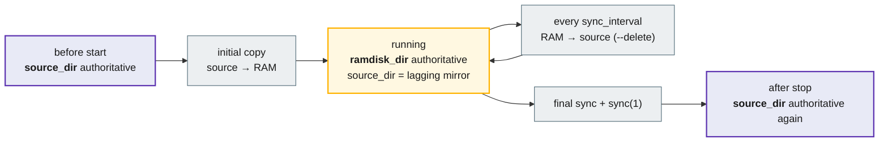
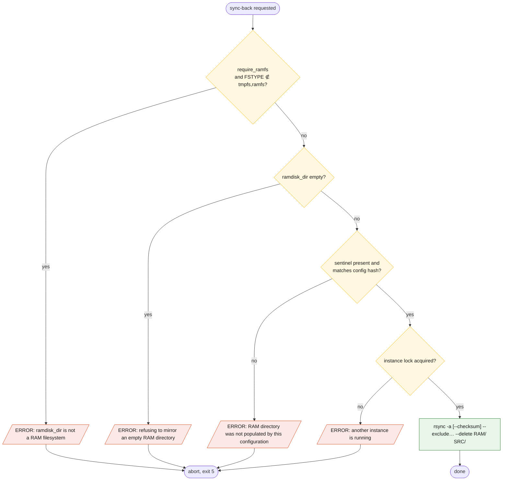
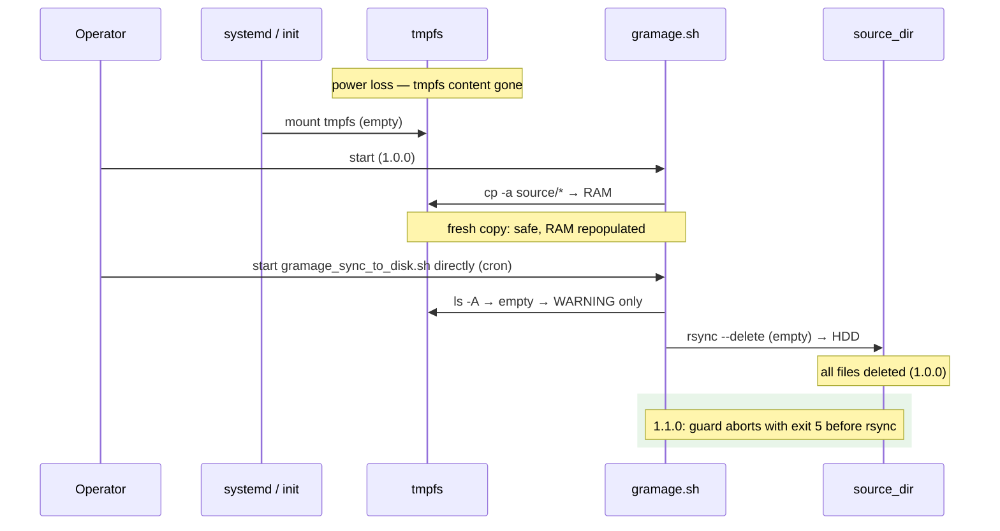

# Data safety model

This page states precisely which copy of the data is authoritative at each moment,
what can destroy data, and which guards exist (or are planned).

## Source of truth over time

Consequences:

- **Edits on `source_dir` while running are lost** at the next sync-back, because the
  mirror is one-directional with `--delete`.
- The **maximum loss on power failure** is the work written to the RAM disk since the
  last completed sync-back: at most `sync_interval` + one rsync duration.
- Files matching `[EXCLUDE]` exist only on the RAM disk and are **never persisted**.

## Hazard analysis

| # | Hazard | Trigger | Effect in 1.0.0 | Guard in 1.1.0 |
|---|--------|---------|-----------------|----------------|
| H1 | Sync-back from an **empty RAM directory** | reboot (tmpfs gone), wrong mount, manual `rm -rf`, `ramdisk_dir` typo | `--delete` removes every file in `source_dir` (reproduced: 25 → 4 files) | abort when the RAM directory is empty |
| H2 | Sync-back from a **partially populated** RAM directory | initial copy interrupted; a second process recreated the directory | files missing on RAM are deleted on disk | sentinel file written only after a successful initial copy; sync-back requires it |
| H3 | `ramdisk_dir` **not on tmpfs** | tmpfs not mounted; script creates a plain directory | no speed-up; still a one-directional mirror with `--delete` | `require_ramfs = true` (default): `findmnt` must report `tmpfs` or `ramfs` |
| H4 | **Two instances** on the same directories | double start, cron + loop | interleaved rsync runs; deletion races | `flock` on a per-RAM-dir lock file |
| H5 | **Nested copy** when `source_dir` has no trailing slash | config style | tree duplicated one level deeper per cycle; disk fills up | path normalisation |
| H6 | **Unattended run without TTY** | nohup / systemd | continuous rsync, I/O saturation, but no data loss | signal-driven wait |
| H7 | **Power loss mid-sync** | — | rsync writes to temp files and renames atomically per file; the tree may mix old and new versions, no truncated files (default `--inplace` off) | unchanged; optional `--backup-dir` snapshots in phase 3 |
| H8 | **Full tmpfs** | workload exceeds `size=` | writes on the RAM disk fail with ENOSPC; whatever was written is mirrored | monitoring recommendation; no change |

## Planned sync-back guard (1.1.0)

Sentinel file: `ramdisk_dir/.gnuramage-sentinel`, containing the SHA-256 of the
normalised `source_dir`/`ramdisk_dir` pair and the time of the last successful
initial copy. It is excluded from the sync-back automatically.

## Invariants

These must hold after any code change:

1. A sync-back with `--delete` never runs against an empty, unverified or
   non-RAM `ramdisk_dir`.
2. Initial copy and sync-back use the same exclude list.
3. Paths are normalised once; rsync always receives the `dir/` form.
4. At most one instance per `ramdisk_dir`.
5. `SIGTERM`/`SIGINT` lead to exactly one final sync and `exit 0`.
6. No fixed paths under `/tmp`.
7. `--dry-run` writes nothing except log files.

## Recovery scenario — tmpfs lost on reboot

Rule of thumb for 1.0.0 operators: **after any reboot, run the initial copy before
any sync-back**, and never schedule `gramage_sync_to_disk.sh` without a preceding
`gramage_copy_to_ram.sh` in the same boot.
