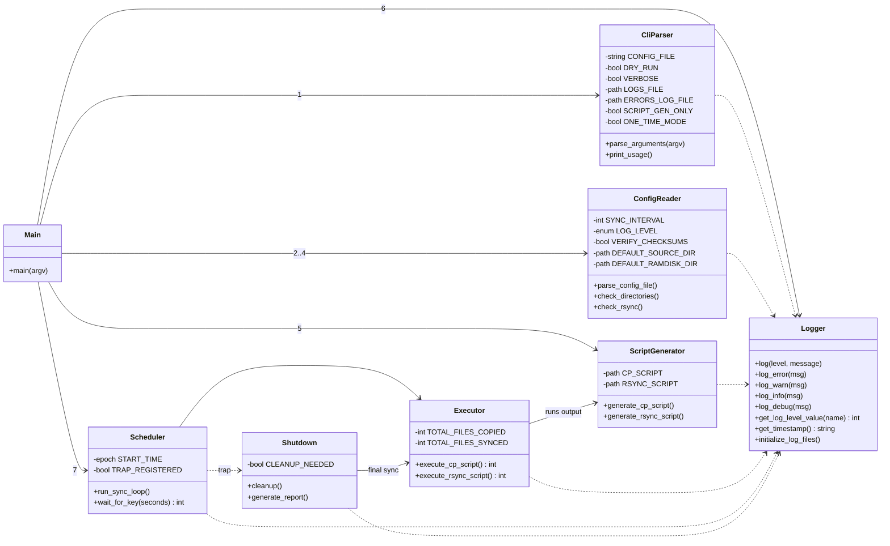
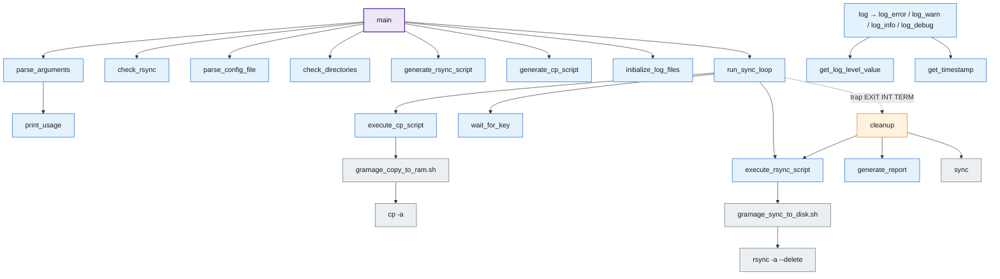

# Function map

`gramage.sh` has no modules or objects; this page presents its functions as if they
were classes grouped by responsibility, plus the real call graph. Line numbers refer
to 1.0.0.

## Logical grouping (UML class view)

## Call graph

Every function except `print_usage`, `get_timestamp` and `get_log_level_value`
calls the logging functions; those edges are omitted for readability.

## Function reference

| Function | Lines | Purpose | Returns / exits |
|----------|-------|---------|-----------------|
| `print_usage` | 52–66 | Print CLI help. | — |
| `get_log_level_value` | 75–83 | Map `ERROR/WARN/INFO/DEBUG` → `0/1/2/3`; unknown → `2`. | stdout |
| `parse_arguments` | 86–128 | `while/case` over `$@`; unknown option → usage, `exit 1`. | — |
| `get_timestamp` | 131–133 | `date "+%Y-%m-%d %H:%M:%S"`. | stdout |
| `log` | 136–164 | Level filter, console (not in dry-run unless ERROR), `--logs`, `--errors-log` for ERROR/WARN. | — |
| `log_error` … `log_debug` | 167–181 | Thin wrappers. | — |
| `check_rsync` | 184–191 | `command -v rsync` or `exit 1`. | — |
| `parse_config_file` | 194–255 | Locate INI; `grep`/`cut`/`tr` per key; `exit 1` on missing section/keys. | — |
| `check_directories` | 258–276 | `source_dir` must exist; `mkdir -p ramdisk_dir` unless dry-run. | `exit 1` |
| `generate_rsync_script` | 279–340 | Heredoc → `gramage_sync_to_disk.sh` with `--exclude` lines appended; `chmod +x`. | — |
| `generate_cp_script` | 343–390 | Heredoc → `gramage_copy_to_ram.sh`; `chmod +x`. | — |
| `execute_cp_script` | 393–426 | Run copy script; count files on RAM. | `0` / `1` |
| `execute_rsync_script` | 429–471 | Run sync script, stderr to temp file; log errors. | `0` / `1` |
| `wait_for_key` | 474–485 | `read -t interval -n 1`. | `1` key, `0` timeout |
| `initialize_log_files` | 488–501 | `touch` log files; header into error log. | — |
| `cleanup` | 504–530 | Guarded by `CLEANUP_NEEDED`; final sync, `sync` ×2, report. | — |
| `generate_report` | 533–547 | Duration and counters via `log_info`. | — |
| `run_sync_loop` | 550–591 | Trap, initial copy, one-time branch, loop. | `exit 0/1` |
| `main` | 594–622 | Orchestration in the order shown in the call graph. | — |

## Global state

| Variable | Set by | Read by | Notes |
|----------|--------|---------|-------|
| `CONFIG_FILE` | CLI, `parse_config_file` (rewritten to script-dir path) | config reader, generators | |
| `DRY_RUN`, `VERBOSE` | CLI | logger, generators, executors, cleanup | `DRY_RUN` suppresses console output except ERROR |
| `LOGS_FILE`, `ERRORS_LOG_FILE` | CLI | logger, `initialize_log_files`, `execute_rsync_script` | |
| `SYNC_INTERVAL` | config | `run_sync_loop` | seconds |
| `LOG_LEVEL` | config | `log` | upper-cased |
| `VERIFY_CHECKSUMS` | config | **nobody** | known issue G |
| `DEFAULT_SOURCE_DIR`, `DEFAULT_RAMDISK_DIR` | config | `check_directories`, generators, `execute_cp_script` | not normalised (known issue C) |
| `RSYNC_SCRIPT`, `CP_SCRIPT` | top level (`SCRIPT_DIR`) | generators, executors | written next to the script |
| `TOTAL_FILES_COPIED`, `TOTAL_FILES_SYNCED` | executors | `generate_report` | second counts cycles, not files |
| `START_TIME` | top level, `run_sync_loop` | `generate_report` | epoch seconds |
| `CLEANUP_NEEDED`, `TRAP_REGISTERED` | `run_sync_loop`, `cleanup` | `cleanup` | idempotence guard |
