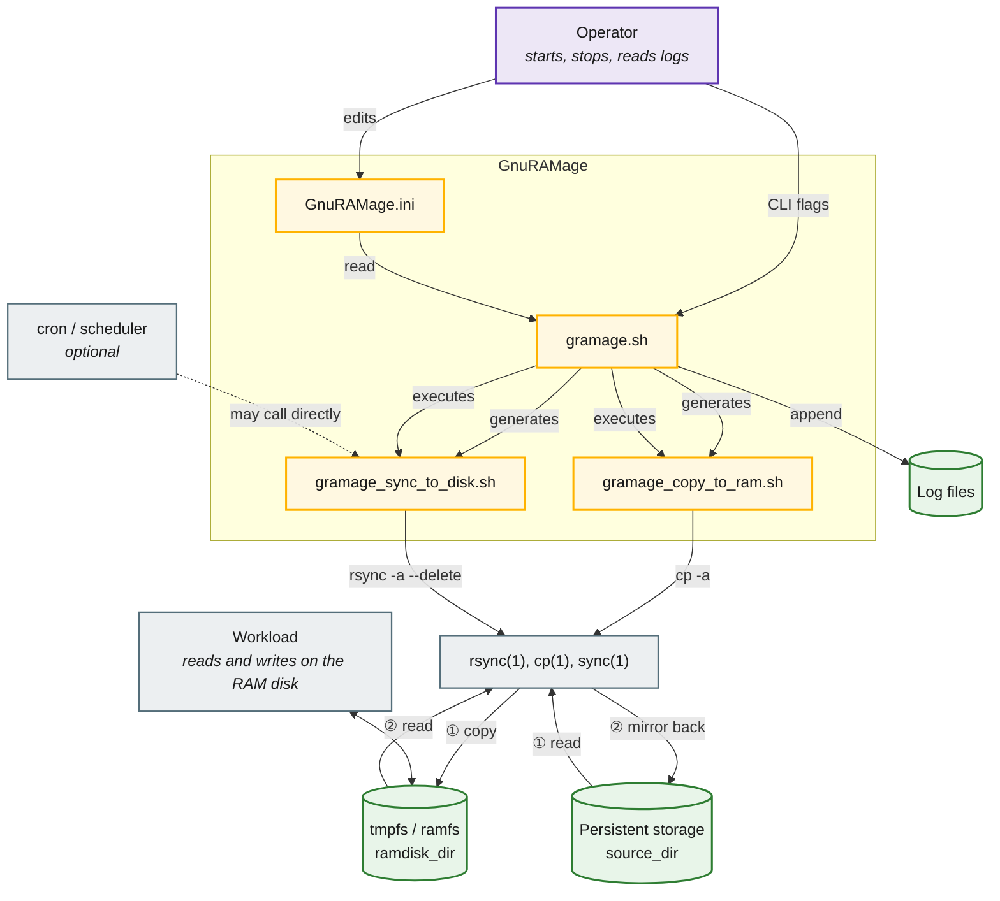
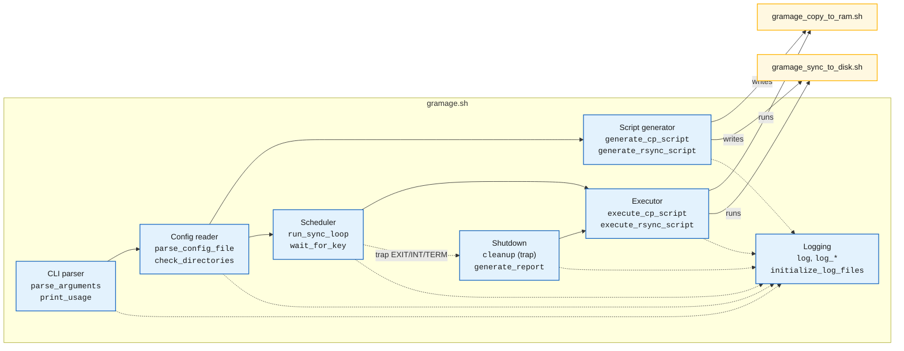
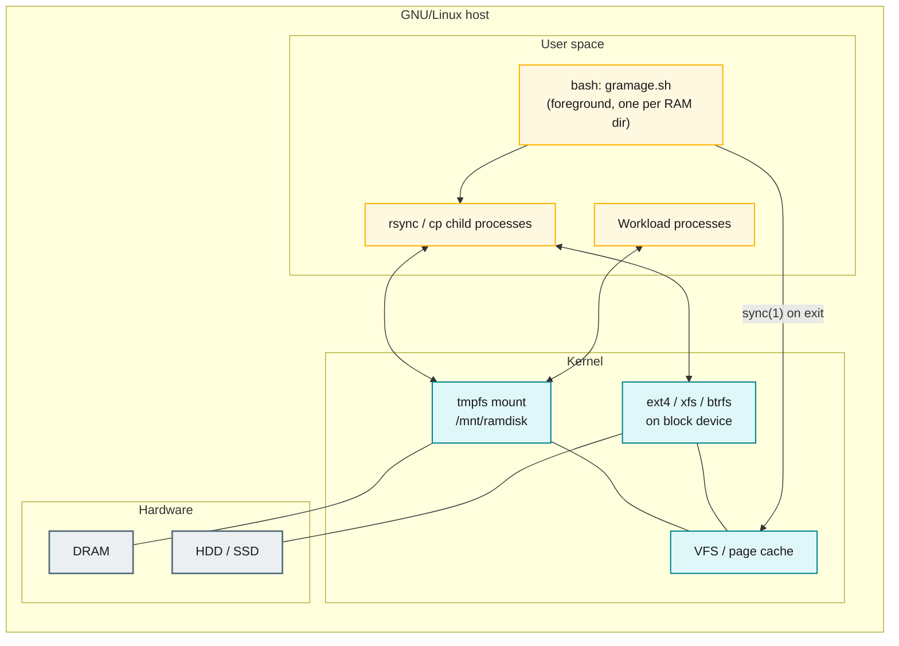
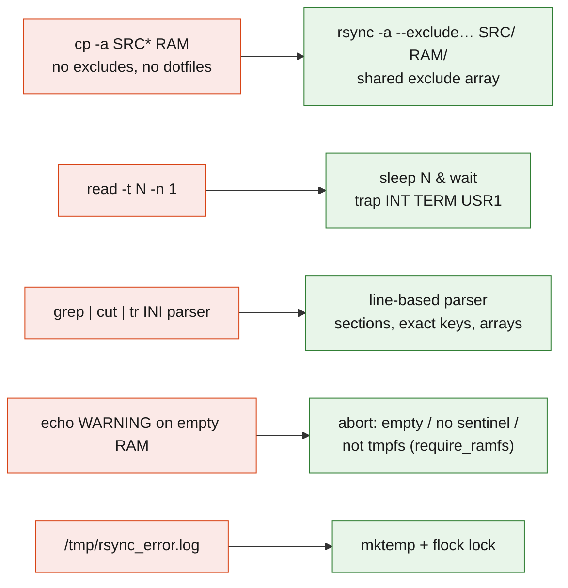

# Architecture overview

GnuRAMage is deliberately small: one Bash file, two generated helper scripts, and
`rsync` doing the actual work. This section documents the system as it exists in
**1.0.0**; planned changes are marked.

## System context

## Component view

The script is organised into functional groups. There are no Bash modules; the
grouping is by naming convention and call pattern (see the
[function map](function-map.md)).

| Group | Responsibility | Globals written |
|-------|----------------|-----------------|
| CLI parser | Translate flags into globals; print usage. | `CONFIG_FILE`, `DRY_RUN`, `VERBOSE`, `LOGS_FILE`, `ERRORS_LOG_FILE`, `SCRIPT_GEN_ONLY`, `ONE_TIME_MODE` |
| Config reader | Locate and parse the INI; validate directories. | `SYNC_INTERVAL`, `LOG_LEVEL`, `VERIFY_CHECKSUMS`, `DEFAULT_SOURCE_DIR`, `DEFAULT_RAMDISK_DIR` |
| Logging | Level filter; console, log file, error file routing. | — |
| Script generator | Render two standalone Bash scripts with paths and excludes baked in. | files on disk |
| Executor | Run a worker script, capture status and stderr, update counters. | `TOTAL_FILES_COPIED`, `TOTAL_FILES_SYNCED` |
| Scheduler | Initial copy, then loop or one-shot. | `START_TIME`, `CLEANUP_NEEDED`, `TRAP_REGISTERED` |
| Shutdown | Final sync, `sync(1)`, report. | `CLEANUP_NEEDED` |

## Deployment view

Properties that follow from this layout:

- The tmpfs content lives in **DRAM only**; a power loss or `umount` discards it.
  Everything written since the last sync-back is lost. The loss window equals
  `sync_interval` plus the duration of one rsync run.
- `rsync` and `cp` are ordinary user processes; throughput is bounded by the
  persistent device during sync-back and by memory bandwidth during the initial copy.
- `sync(1)` after the final rsync forces dirty pages to the block device, so a
  controlled stop is durable even if the host is powered off immediately afterwards.

## Design constraints

| Constraint | Consequence |
|------------|-------------|
| Single Bash file, no external libraries | Portability across distributions; no package manager required. |
| `rsync -a --delete` for sync-back | Exact mirror; deletions propagate; `--exclude` keeps junk on the RAM disk only. |
| RAM disk is authoritative after start | Edits made directly on persistent storage while running are **overwritten** on the next sync-back. |
| Worker scripts generated from config | Same behaviour available to cron without the main loop; paths and excludes cannot drift between the two runners. |
| Interactive wait (`read -t`) | Simple, but ties 1.0.0 to a TTY — replaced by a signal-driven wait in 1.1.0. |

## Planned 1.1.0 structural changes

Details: [Known issues](../development/known-issues.md) and
[Roadmap](../development/roadmap.md).
