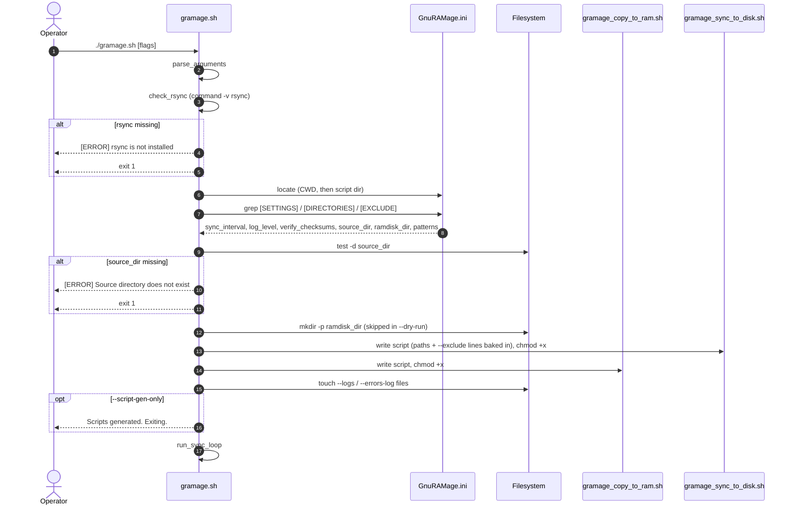
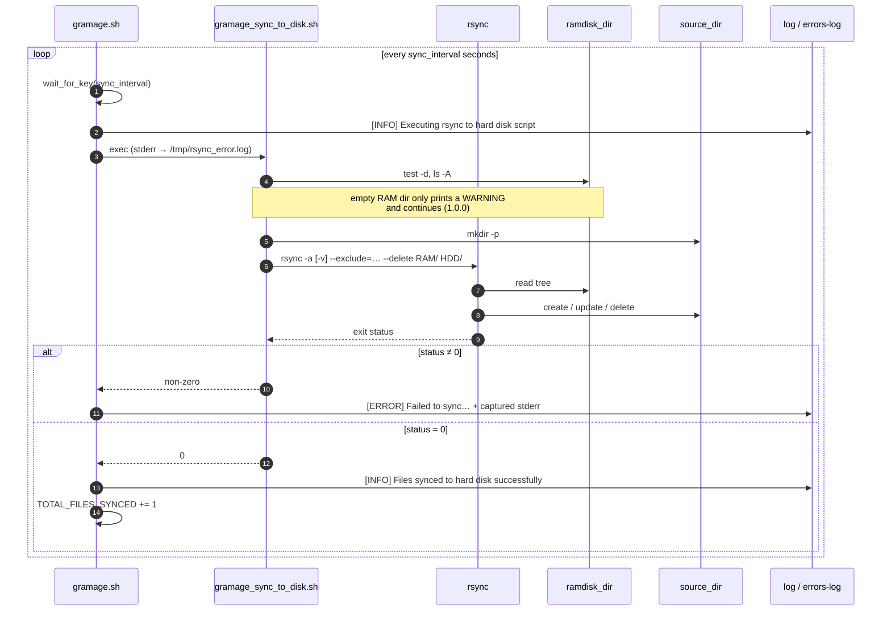
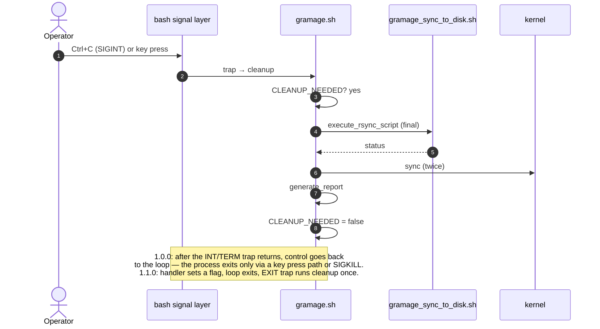
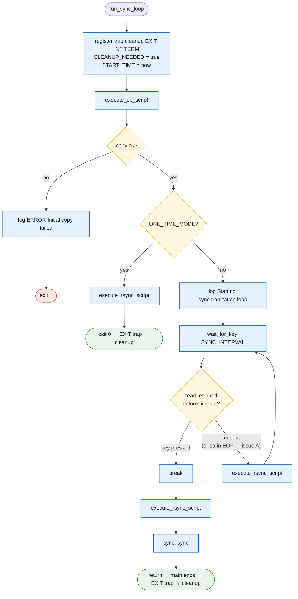
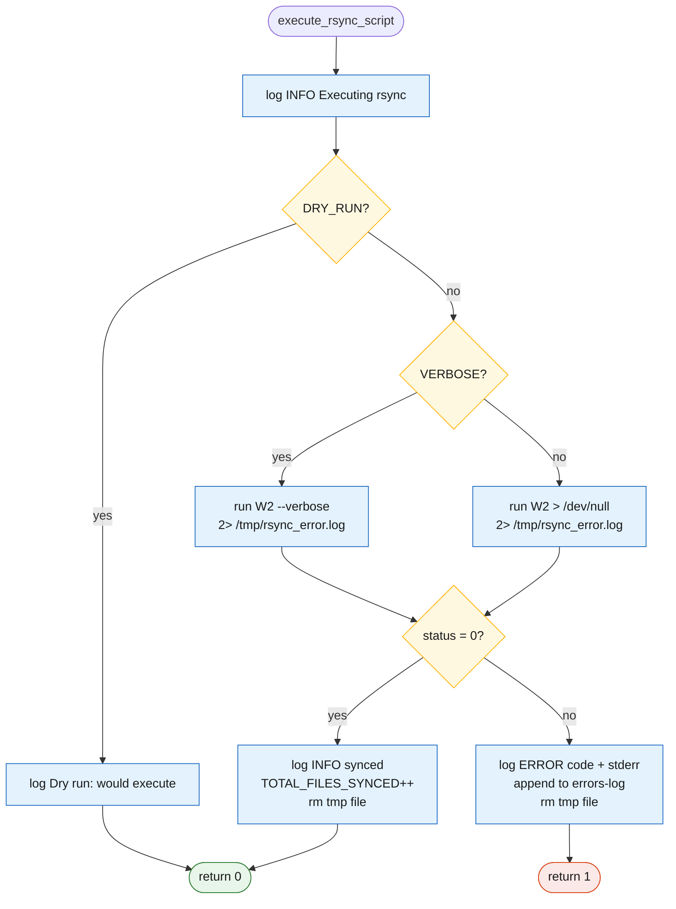
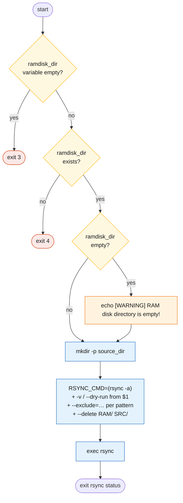
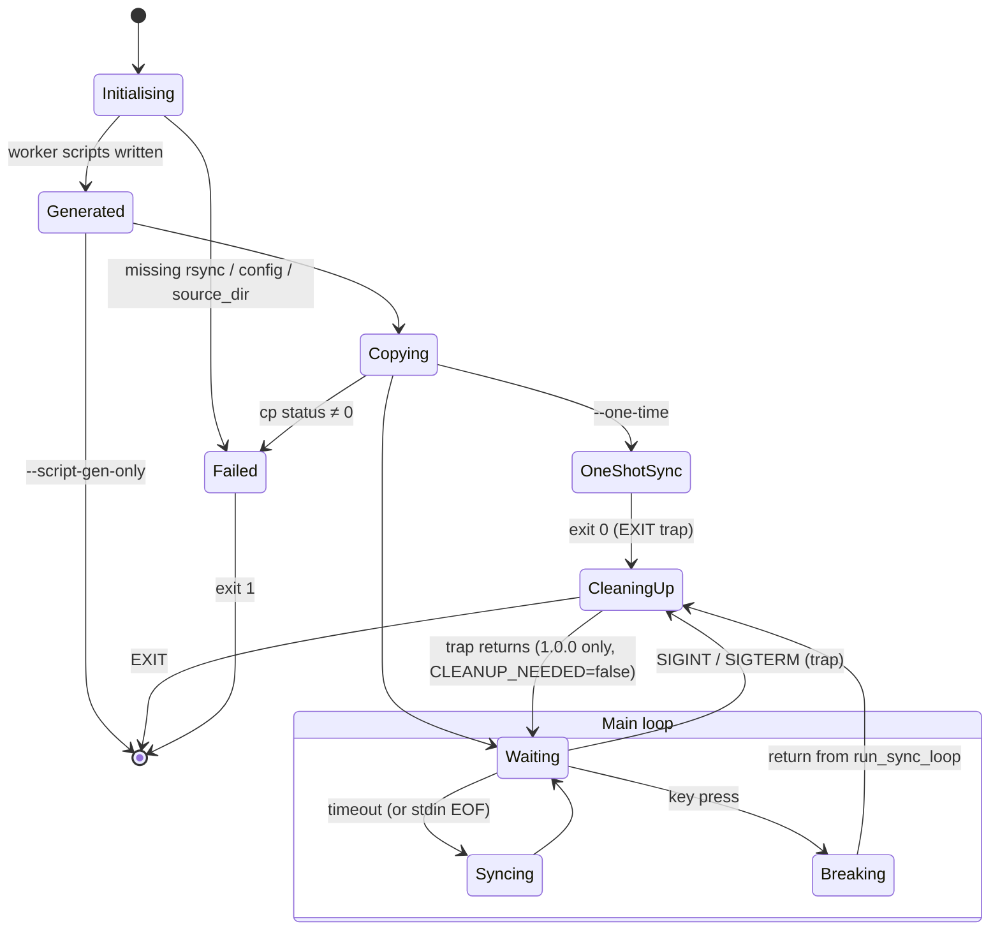

# Runtime behaviour

Sequence, activity and state views of one run of `gramage.sh` (1.0.0 semantics).

## Start-up sequence

## Sync cycle sequence

## Shutdown sequence

## Activity diagram — main loop

!!! note "Double final sync"
    On a key press the loop performs a sync-back (`M`), then `cleanup` on `EXIT`
    performs another one. Harmless (rsync is idempotent) but slow on large trees;
    collapsed into one in 1.1.0.

## Activity diagram — `execute_rsync_script`

## Activity diagram — generated `gramage_sync_to_disk.sh`

!!! danger "The WARNING branch is the data-loss path"
    An empty `ramdisk_dir` reaches `rsync --delete` and empties `source_dir`.
    See [Data safety model](data-safety.md).

## Process state machine (1.0.0, with signal detail)

## Signal and exit handling

| Event | 1.0.0 behaviour | 1.1.0 target |
|-------|-----------------|--------------|
| Key press on stdin | loop breaks, final sync, exit 0 | kept when stdin is a TTY |
| `SIGINT` (Ctrl+C) | `cleanup` runs (final sync, report); loop resumes; second Ctrl+C during `read` breaks the loop | flag set, `sleep` killed, loop exits, one `cleanup`, exit 0 |
| `SIGTERM` | same as SIGINT — process does not exit | as SIGINT |
| `SIGUSR1` | default action (terminates without cleanup) | immediate sync-back, loop continues |
| `SIGHUP` | default action (terminates without cleanup) | ignore or reload config — to be decided |
| `exit N` anywhere | `EXIT` trap → `cleanup` if `CLEANUP_NEEDED` | unchanged |
