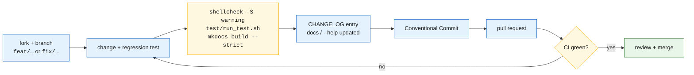

# Contributing

## Workflow



## Local checks

```bash
# Lint — same severity as CI
shellcheck -S warning gramage.sh test/*.sh

# Tests (needs rsync)
cd test && ./run_test.sh && cd ..

# Docs
python -m pip install -r docs/requirements.txt
mkdocs serve          # http://127.0.0.1:8000
mkdocs build --strict
```

## Conventions

| Area | Rule |
|------|------|
| Shell | Bash ≥ 4; `#!/usr/bin/env bash`; `set -euo pipefail` once 1.1.0 lands |
| Style | 4-space indent; `snake_case` functions; `UPPER_CASE` globals; `local` for every function variable; declare and assign on separate lines (SC2155) |
| Quoting | quote every expansion; arrays for command construction |
| Errors | `if ! cmd; then` rather than `$?` checks |
| Logging | only through `log_*`; never bare `echo` in the main script |
| Temp files | `mktemp`, removed in a trap |
| Tests | every bug fix adds a regression test; tests use temporary directories, never fixed `/tmp` paths or real user data |
| Docs | diagrams in Mermaid inside the Markdown; no binary diagram sources |
| Commits | [Conventional Commits](https://www.conventionalcommits.org/): `feat:`, `fix:`, `docs:`, `test:`, `ci:`, `chore:`, `refactor:`; reference known-issue IDs (`Fixes defect B`) |
| Language | English in code, comments, commits and docs |

## Definition of done for a change

- [ ] ShellCheck clean at `warning`
- [ ] `test/run_test.sh` passes locally
- [ ] regression test added or updated
- [ ] `CHANGELOG.md` entry under *Unreleased*
- [ ] `--help`, README and docs reflect any CLI or config change
- [ ] CI green on all three distributions
