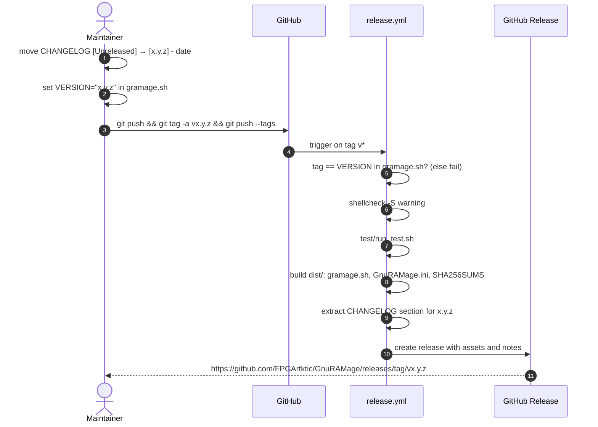

# Release process

Releases are cut from `master` by pushing an annotated tag. The `Release` workflow
does the rest.



## Checklist

1. All CI jobs green on `master`.
2. `CHANGELOG.md`: rename `[Unreleased]` to `[x.y.z] - YYYY-MM-DD`, add a fresh empty
   `[Unreleased]` above it, update the compare links at the bottom.
3. `gramage.sh`: set `VERSION="x.y.z"` (1.1.0+) and the `# Version:` header line.
4. Commit: `chore(release): x.y.z`.
5. Tag and push:

    ```bash
    git tag -a vx.y.z -m "GnuRAMage x.y.z"
    git push origin master --tags
    ```

6. Watch the *Release* workflow; verify the assets and the `SHA256SUMS` file.
7. Read the Docs builds the `latest` version from `master` automatically; tag
   builds appear as versioned docs when enabled in the RTD project settings.

## Versioning

[Semantic Versioning](https://semver.org/):

| Change | Bump |
|--------|------|
| bug fix, docs, CI | patch |
| new flag or config key, backwards compatible | minor |
| removed or renamed flag/key, changed default behaviour | major |

Pre-releases use `vx.y.z-rc.N`; the workflow marks them as pre-release on GitHub.

## Retroactive `v1.0.0` tag

The initial release was never tagged. To make the compare links and the release
badge meaningful:

```bash
git tag -a v1.0.0 17a7680 -m "GnuRAMage 1.0.0 (retroactive tag)"
git push origin v1.0.0
```

The release workflow does not run for this tag — the workflow file did not exist
at that commit — so no GitHub Release is created for 1.0.0; create one manually
from the tag if desired.
