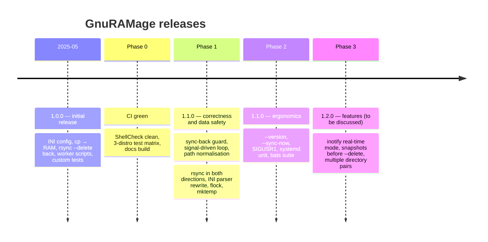
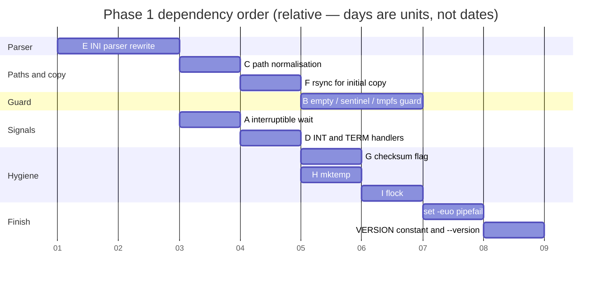

# Roadmap

Phases are ordered; each is one or more pull requests. Dates are intentionally
absent — the project is maintained in spare time.

## Phase 0 — CI green

- [x] Fix all ShellCheck findings (issue J) without behaviour change.
- [x] Generated sync script honours `--verbose` / `--dry-run` (issue K).
- [ ] Confirm `ci.yml` passes on Ubuntu, Debian and Arch.
- [ ] Docs build with `mkdocs build --strict`.

## Phase 1 — correctness and data safety → 1.1.0

Order matters: the parser rewrite comes first because every later fix reads
configuration through it; `set -euo pipefail` comes last because it changes the
meaning of every unchecked command.

- [ ] **E** line-based INI parser; fixture with spaces, comments, duplicate keys,
      the five "forbidden" words.
- [ ] **C** `realpath -m` normalisation; always `dir/` to rsync.
- [ ] **F** initial copy via rsync with the shared exclude array; dotfiles included;
      remove the `.rsyncignore` marker.
- [ ] **B** refuse sync-back on empty RAM dir / missing sentinel / not tmpfs
      (`require_ramfs`, default `true`).
- [ ] **A** `sleep & wait` loop; key-press shortcut only on a TTY.
- [ ] **D** INT/TERM set a flag and kill `sleep`; single `cleanup` on EXIT; `exit 0`.
- [ ] **G** `--checksum` when `verify_checksums = true`.
- [ ] **H** `mktemp` for rsync stderr.
- [ ] **I** `flock` instance lock, exit 2.
- [ ] `set -euo pipefail` after all `$?` checks are rewritten.
- [ ] `VERSION="1.1.0"` and `--version`.

## Phase 2 — ergonomics → 1.1.0

- [ ] `--sync-now`; `SIGUSR1` → immediate sync-back inside the loop.
- [ ] `contrib/gnuramage.service` (`Type=simple`, `TimeoutStopSec` ≥ rsync duration,
      `Restart=on-failure`); documented in Operations.
- [ ] Config lookup: `--config` → `$XDG_CONFIG_HOME/gnuramage/config.ini` →
      `/etc/gnuramage/config.ini` → script directory.
- [ ] `--json` log output (NDJSON) or drop the claim from `--help`.
- [ ] bats-core suite with the regression matrix from [Testing](testing.md).
- [ ] Decide the fate of worker-script generation (keep as export feature from the
      same argument array, or remove and bump to 2.0.0).

## Phase 3 — features → 1.2.0 (needs a design discussion first)

- [ ] Real-time mode: `inotifywait -m -r` with debounce instead of a fixed interval.
- [ ] Snapshot before each `--delete` sync (`--backup --backup-dir` or
      `--link-dest`) with retention.
- [ ] Several `[DIRECTORIES]` pairs per configuration.

## Non-goals

- Rewrite in another language — single-file Bash is the point.
- Bidirectional synchronisation — the RAM disk is authoritative by design.
- Network targets — use rsync directly for that.
