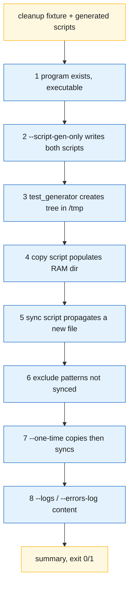

# Testing

## Current suite (1.0.0)

`test/run_test.sh` is a self-contained runner (no framework). It uses
`test/test_generator.sh` to build a fixture tree, then drives `gramage.sh` and the
generated worker scripts.

```bash
cd test
./run_test.sh                                   # 18 assertions in 8 groups
./test_generator.sh --files 500 --dirs 20 --size 1M   # bigger fixture
```



### Limitations

- Fixed paths `/tmp/ram_disk_test_source` and `/tmp/ram_disk_test_ramdisk`: no
  parallel runs; stale state from an aborted run can leak into the next one.
- Assertions are coarse (`find | wc -l > 0`). The suite passes with the
  [known issues](known-issues.md) present — including the nested-copy bug that its
  own fixture triggers.
- Test 8 provokes an rsync error with `chmod 444`; as root (CI containers) the
  permission is ignored, so the error path is not exercised there.

## CI matrix

| Job | Runner | What |
|-----|--------|------|
| `lint` | ubuntu-latest | `shellcheck -S warning` over the repository |
| `test (ubuntu-latest)` | VM | `test/run_test.sh` |
| `test (debian-bookworm)` | container | same, rsync 3.2.7 |
| `test (archlinux)` | container | same, rsync 3.4.x |
| `docs` | ubuntu-latest | `mkdocs build --strict` |

Workflow file: `.github/workflows/ci.yml`.

## Target suite (1.1.0) — bats-core

The suite moves to [bats-core](https://github.com/bats-core/bats-core) with
per-test temporary directories.

```bash
test/
  helpers/fixture.bash      # mk_tree, mk_config, fake_rsync
  cli.bats                  # --help, unknown flag, --version
  config.bats               # INI parser cases
  copy.bats                 # initial copy, dotfiles, excludes
  sync.bats                 # sync-back, --delete, guard
  signals.bats              # SIGTERM, SIGINT, SIGUSR1, non-TTY wait
  lock.bats                 # flock behaviour
```

### Regression matrix

| Test | Covers | Assertion |
|------|--------|-----------|
| `non_tty_wait` | A | `< /dev/null`, `sync_interval=10`, killed after 3 s → at most 1 sync in the log |
| `sigterm_exits` | D | background, `kill -TERM` → gone within 3 s, exit 0, final sync logged |
| `empty_ramdisk_abort` | B | empty RAM dir → sync-back exits non-zero, source count unchanged |
| `no_sentinel_abort` | B/H2 | RAM dir hand-populated, no sentinel → refuses |
| `not_tmpfs_abort` | H3 | plain directory with `require_ramfs=true` → refuses; passes with `false` |
| `trailing_slash_idempotent` | C | 3 × `--one-time` with/without trailing slashes → identical trees, no nesting |
| `exclude_words` | E | `baseline/`, `*.format`, `my pattern.txt` → excluded in both directions |
| `dotfiles_copied` | F | top-level `.hidden` present on RAM after initial copy |
| `path_with_spaces` | E | `source_dir = /tmp/x y/` works |
| `checksum_flag` | G | `verify_checksums=true` → rsync argv contains `--checksum` |
| `instance_lock` | I | second instance exits 2 with "already running" |
| `one_time_single_sync` | — | `--one-time` runs exactly one sync-back |

### Asserting rsync arguments

Put a fake `rsync` first on `PATH` that records its arguments:

```bash
fake_rsync() {
    mkdir -p "$BATS_TEST_TMPDIR/bin"
    cat > "$BATS_TEST_TMPDIR/bin/rsync" <<'EOF'
#!/usr/bin/env bash
printf '%s\n' "$@" >> "${RSYNC_ARGS_FILE:?}"
exit 0
EOF
    chmod +x "$BATS_TEST_TMPDIR/bin/rsync"
    export PATH="$BATS_TEST_TMPDIR/bin:$PATH"
    export RSYNC_ARGS_FILE="$BATS_TEST_TMPDIR/rsync.args"
}
```

### Provoking rsync errors as root

`chmod` is ineffective for root. Use a destination that cannot exist
(`source_dir=/proc/gnuramage-test`) or a read-only bind mount
(`mount --bind -o ro`) inside the container.
