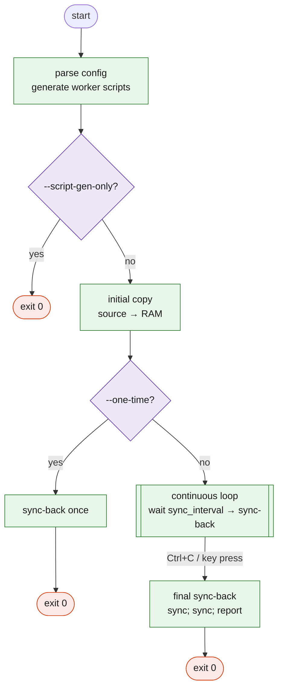

# Command line

```
gramage.sh [OPTIONS]
```

| Option | Argument | Effect |
|--------|----------|--------|
| `--config` | `<file>` | Configuration file. Default `GnuRAMage.ini` (CWD, then script directory). |
| `--dry-run` | — | Log intended actions; perform no copy, sync or `mkdir`. Console output limited to `ERROR` lines. |
| `--verbose`, `-v` | — | Pass `-v` to `cp` and `rsync`; show their output. |
| `--logs` | `<file>` | Append every emitted log line to `<file>`. |
| `--errors-log` | `<file>` | Append `ERROR` and `WARN` lines to `<file>` (header line written on start). |
| `--one-time` | — | Initial copy → one sync-back → exit. |
| `--script-gen-only` | — | Write the two worker scripts and exit without copying. |
| `--help` | — | Print usage and exit `0`. |

Unknown options print usage and exit `1`.

## Exit status

| Code | Meaning |
|------|---------|
| `0` | Normal completion, including after ++ctrl+c++ with a successful final sync. |
| `1` | `rsync` missing, configuration file missing or invalid, `source_dir` missing, cannot create `ramdisk_dir`, initial copy failed, unknown option. |

The generated worker scripts have their own codes: `3` empty path variable, `4`
RAM directory missing, `1` copy failure.

## Mode matrix



## Generated worker scripts

Both are regenerated on every start (unless `--dry-run`) in the directory that
contains `gramage.sh`. They embed the configured paths and exclude patterns, so they
run without the INI file.

| Script | Direction | Accepted flag | Behaviour |
|--------|-----------|---------------|-----------|
| `gramage_copy_to_ram.sh` | `source_dir` → `ramdisk_dir` | `--verbose` \| `--dry-run` | `cp -a "$source_dir"* "$ramdisk_dir"`; with `--dry-run` only prints the intended copy. |
| `gramage_sync_to_disk.sh` | `ramdisk_dir` → `source_dir` | `--verbose` \| `--dry-run` | `rsync -a --delete --exclude=… "$ramdisk_dir/" "$source_dir/"`; refuses when the RAM directory is missing (exit 4); **only warns** when it is empty. |

Example cron usage:

```cron
# sync-back every 5 minutes; initial copy is done once at boot by hand
*/5 * * * *  /home/user/opt/gnuramage/gramage_sync_to_disk.sh >> /var/log/gnuramage.log 2>&1
```

## Examples

```bash
# Preview with full detail
./gramage.sh --config prod.ini --dry-run --verbose

# Unattended one-shot inside a script
./gramage.sh --config prod.ini --one-time --logs /var/log/gnuramage.log

# Regenerate worker scripts after editing the INI
./gramage.sh --config prod.ini --script-gen-only
```
