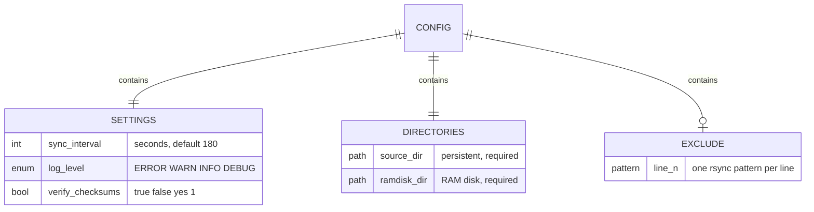

# Configuration

GnuRAMage reads one INI file. The file is resolved in this order:

1. the path given with `--config <file>`;
2. `GnuRAMage.ini` in the current working directory;
3. `GnuRAMage.ini` next to `gramage.sh`.

## Data model



## Syntax

- Sections are written as `[NAME]`, case-sensitive, one per file.
- Keys are `key = value`; whitespace around `=` is ignored.
- Lines starting with `#` or `;` are comments.
- `[EXCLUDE]` has no keys — every non-comment line is a pattern.

## Reference

### `[SETTINGS]`

| Key | Type | Default | Description |
|-----|------|---------|-------------|
| `sync_interval` | integer, seconds | `180` | Pause between sync-back cycles in continuous mode. |
| `log_level` | `ERROR` · `WARN` · `INFO` · `DEBUG` | `INFO` | Minimum level emitted to console and log files. Case-insensitive. |
| `verify_checksums` | `true` · `false` · `yes` · `1` | `false` | Intended to add `--checksum` to rsync. **Parsed but not applied in 1.0.0** ([known issue G](../development/known-issues.md)). |

### `[DIRECTORIES]`

| Key | Required | Description |
|-----|----------|-------------|
| `source_dir` | yes | Directory on persistent storage. Must exist. In 1.0.0, end it with `/`. |
| `ramdisk_dir` | yes | Directory on the RAM disk. Created with `mkdir -p` if missing. |

!!! danger "`ramdisk_dir` is created if missing"
    If the tmpfs is not mounted, 1.0.0 silently creates the directory on the root
    filesystem and continues. You get no speed-up and the sync-back still runs. The
    1.1.0 `require_ramfs` check refuses to start in that case.

### `[EXCLUDE]`

One rsync pattern per line, passed as `--exclude=PATTERN` to the sync-back.

```ini
[EXCLUDE]
*.bak
*.tmp
temp_*
cache/
```

Pattern semantics follow `rsync(1)` *FILTER RULES*: a trailing `/` matches
directories only; a leading `/` anchors to the transfer root; `*` does not cross
directory boundaries, `**` does.

!!! bug "1.0.0 parser limitations"
    - Patterns containing the words `line`, `format`, `pattern`, `exclude` or
      `synchronization` are dropped (they collide with the comment filter).
    - Patterns containing spaces are split into several patterns.
    - Excludes apply to the sync-back only; the initial copy ignores them.

    All three are addressed in 1.1.0 — see [known issues E and F](../development/known-issues.md).

## Example files

=== "Production"

    ```ini
    [SETTINGS]
    sync_interval = 300
    log_level = WARN
    verify_checksums = false

    [DIRECTORIES]
    source_dir = /srv/build-cache/
    ramdisk_dir = /mnt/ramdisk/build-cache

    [EXCLUDE]
    *.o
    *.lock
    tmp/
    ```

=== "Test fixture"

    ```ini
    --8<-- "test/gramage_test.ini"
    ```
