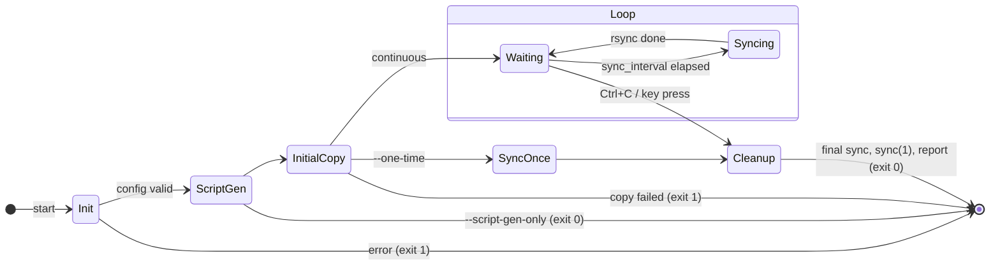

# Operations

## Process lifecycle



## Starting

```bash
./gramage.sh --config prod.ini --logs /var/log/gnuramage.log --errors-log /var/log/gnuramage.err
```

On start the script:

1. checks that `rsync` is on `PATH`;
2. parses the INI; aborts on a missing `[DIRECTORIES]` section or key;
3. verifies `source_dir` exists and creates `ramdisk_dir` if needed;
4. (re)generates the worker scripts;
5. runs the initial copy;
6. enters the loop.

## Stopping

Press ++ctrl+c++ (or any key — the loop uses `read -t`) in the terminal that runs
the script. The `cleanup` handler then:

1. runs one final sync-back;
2. calls `sync` twice to flush the page cache;
3. prints a report: start/end time, duration, files on the RAM disk, sync cycles.

!!! failure "SIGTERM does not terminate 1.0.0"
    A `kill -TERM` runs the cleanup handler but the loop resumes afterwards; the
    process stays alive until `SIGKILL`. Use ++ctrl+c++ in the terminal, or
    `kill -INT` followed by a second `kill -INT` if it keeps running.
    Fixed in 1.1.0 ([known issue D](../development/known-issues.md)).

## Running unattended

!!! warning "Interactive terminal required in 1.0.0"
    The wait loop reads from stdin. With stdin closed (`nohup`, `systemd`, `&` in a
    non-interactive shell, `< /dev/null`) `read` returns immediately and the sync-back
    runs **continuously without pause** ([known issue A](../development/known-issues.md)).

Until 1.1.0, two supported alternatives:

=== "tmux / screen"

    ```bash
    tmux new -d -s gnuramage './gramage.sh --config prod.ini --logs /var/log/gnuramage.log'
    tmux attach -t gnuramage        # Ctrl+C to stop
    ```

=== "cron with worker scripts"

    ```bash
    ./gramage.sh --config prod.ini --script-gen-only
    ./gramage_copy_to_ram.sh                  # once, after mounting tmpfs
    crontab -e
    # */5 * * * * /path/gramage_sync_to_disk.sh >> /var/log/gnuramage.log 2>&1
    ```

    No final sync on shutdown — add `gramage_sync_to_disk.sh` to your shutdown
    sequence yourself.

Planned for 1.1.0: a signal-driven loop, `SIGUSR1` → sync now, and
`contrib/gnuramage.service`.

## Logging

Format: `[YYYY-MM-DD HH:MM:SS] [LEVEL] message`

| Destination | Content |
|-------------|---------|
| stdout | lines at or above `log_level`; in `--dry-run` only `ERROR` |
| `--logs <file>` | same lines as stdout, appended |
| `--errors-log <file>` | `ERROR` and `WARN` lines, plus rsync's stderr on failure |

Levels in increasing verbosity: `ERROR` < `WARN` < `INFO` < `DEBUG`.

## Monitoring suggestions

- Alert on any `[ERROR]` line in the error log.
- Compare `find ramdisk_dir -type f | wc -l` with the source periodically.
- Track `df -h /mnt/ramdisk` — a full tmpfs makes writes fail inside the RAM disk,
  and the next sync-back will faithfully mirror whatever the application managed to
  write.
