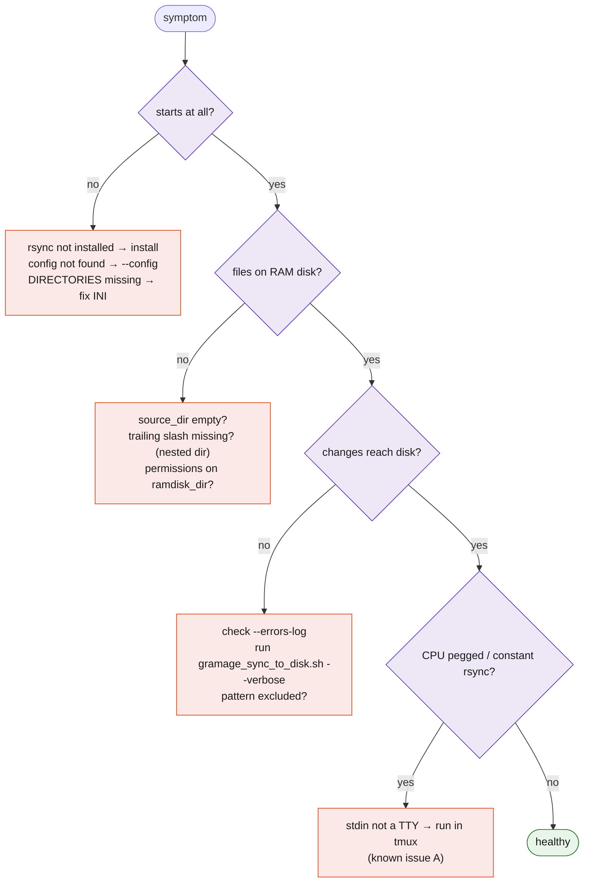

# Troubleshooting

## Diagnostic flow



## Symptoms

### `rsync is not installed`

```bash
sudo apt install rsync        # Debian/Ubuntu
sudo pacman -S rsync          # Arch
sudo dnf install rsync        # Fedora
```

### `Configuration file 'GnuRAMage.ini' not found`

The file is looked up in the current directory, then next to the script. Pass an
absolute path with `--config`.

### `DIRECTORIES section not found` / `Source directory not specified`

Section and key names are case-sensitive: `[DIRECTORIES]`, `source_dir`,
`ramdisk_dir`.

### RAM disk contains a copy of the source *directory*, not its contents

`source_dir` lacks a trailing slash. Add it, delete the nested copy on both sides,
restart. See [known issue C](../development/known-issues.md).

### A file I expected is missing from the RAM disk

- Top-level dotfiles are not copied by the 1.0.0 initial copy
  ([known issue F](../development/known-issues.md)).
- The initial copy does not apply `[EXCLUDE]`; the sync-back does. A file created
  on the RAM disk that matches a pattern never reaches persistent storage — by
  design.

### An exclude pattern is ignored

Patterns containing `line`, `format`, `pattern`, `exclude` or `synchronization`,
or containing spaces, are mishandled by the 1.0.0 parser
([known issue E](../development/known-issues.md)). Rename the pattern or wait
for 1.1.0.

### rsync runs continuously, CPU at 100 %

stdin is not a terminal. Run inside `tmux`/`screen`, or use the cron workflow.
See [Operations → Running unattended](operations.md#running-unattended).

### Process does not stop on `kill`

Use ++ctrl+c++ in its terminal. `SIGTERM` runs the final sync but does not exit in
1.0.0 ([known issue D](../development/known-issues.md)).

### Files disappeared from persistent storage

The sync-back ran with an empty or incomplete RAM disk (tmpfs lost after reboot,
wrong mount, manual `rm`). `--delete` mirrored that state. Restore from backup; then
read the [data safety model](../architecture/data-safety.md) and the guard planned
in 1.1.0 ([known issue B](../development/known-issues.md)).

### `Permission denied` in the error log during sync-back

A file or directory on `source_dir` is not writable by the user running the script,
or the destination is on a read-only mount. Run `gramage_sync_to_disk.sh --verbose`
to see the exact path.

## Collecting a bug report

```bash
./gramage.sh --config my.ini --dry-run --verbose 2>&1 | head -50
bash --version | head -1; rsync --version | head -1
findmnt -no FSTYPE,OPTIONS --target /path/to/ramdisk
cat my.ini          # redact paths if needed
```

Open an issue at <https://github.com/FPGArtktic/GnuRAMage/issues> with the output,
the expected behaviour and the observed one.
