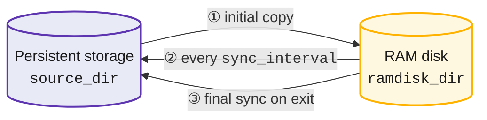

  

# GnuRAMage

**RAM disk mirroring with periodic `rsync` write-back, in a single Bash script.**

GnuRAMage copies a directory tree from persistent storage to a RAM disk, keeps the
persistent copy current with periodic `rsync --delete`, and performs a final sync on
exit. It targets hosts with large tmpfs/ramfs mounts where a workload needs RAM-speed
I/O but a power loss must not cost work.

-   :material-rocket-launch:{ .lg .middle } **Getting started**

    ---

    Install, mount a tmpfs, write a 10-line INI file, run.

    [:octicons-arrow-right-24: Guide](guide/getting-started.md)

-   :material-sitemap:{ .lg .middle } **Architecture**

    ---

    Component, deployment, sequence, activity and state diagrams of the script.

    [:octicons-arrow-right-24: Architecture](architecture/index.md)

-   :material-shield-alert:{ .lg .middle } **Data safety model**

    ---

    Which copy is the source of truth, what `--delete` means, and the guards.

    [:octicons-arrow-right-24: Data safety](architecture/data-safety.md)

-   :material-bug:{ .lg .middle } **Known issues & roadmap**

    ---

    Verified defects in 1.0.0 and the 1.1.0 plan.

    [:octicons-arrow-right-24: Known issues](development/known-issues.md)

## At a glance

| | |
|---|---|
| Language | Bash ≥ 4.0, single file (`gramage.sh`) |
| Dependencies | `rsync` ≥ 3.1, coreutils, findutils |
| Configuration | INI file (`[SETTINGS]`, `[DIRECTORIES]`, `[EXCLUDE]`) |
| Modes | continuous loop, `--one-time`, `--dry-run`, `--script-gen-only` |
| License | GPL-3.0-or-later |
| Source | [github.com/FPGArtktic/GnuRAMage](https://github.com/FPGArtktic/GnuRAMage) |

!!! warning "Source of truth"
    After the initial copy the **RAM disk is authoritative**. The sync-back runs
    `rsync -a --delete RAM/ → source/`. Read the
    [data safety model](architecture/data-safety.md) before using it on data you
    care about, and note the [known issues](development/known-issues.md) of 1.0.0.
